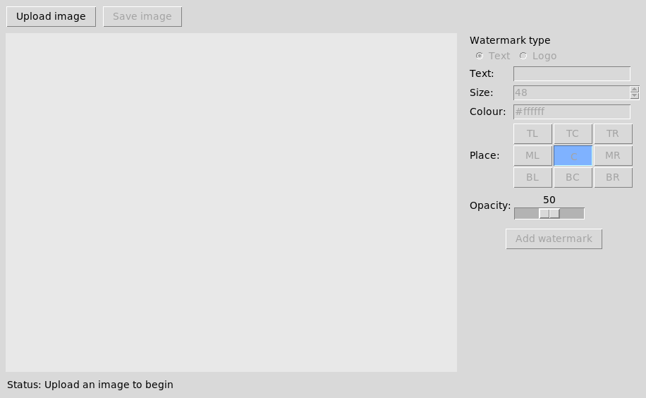
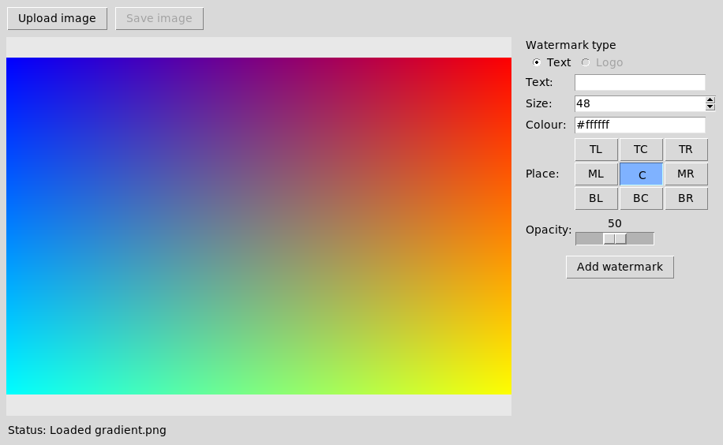
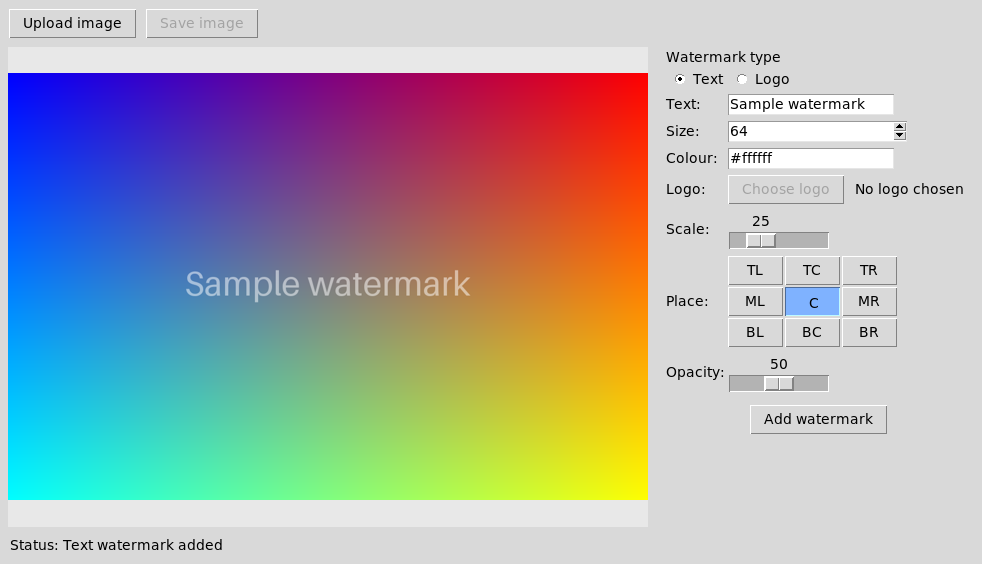
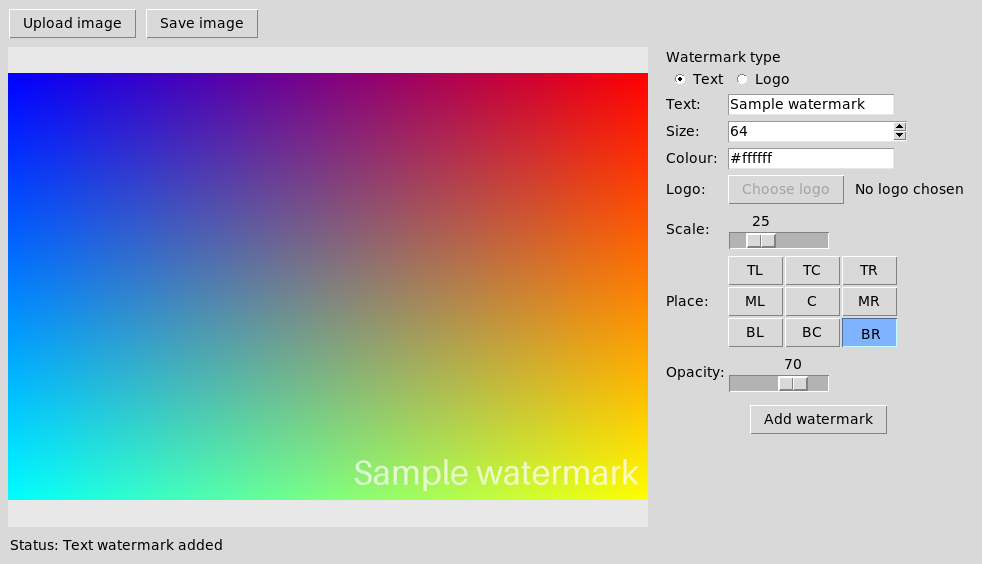
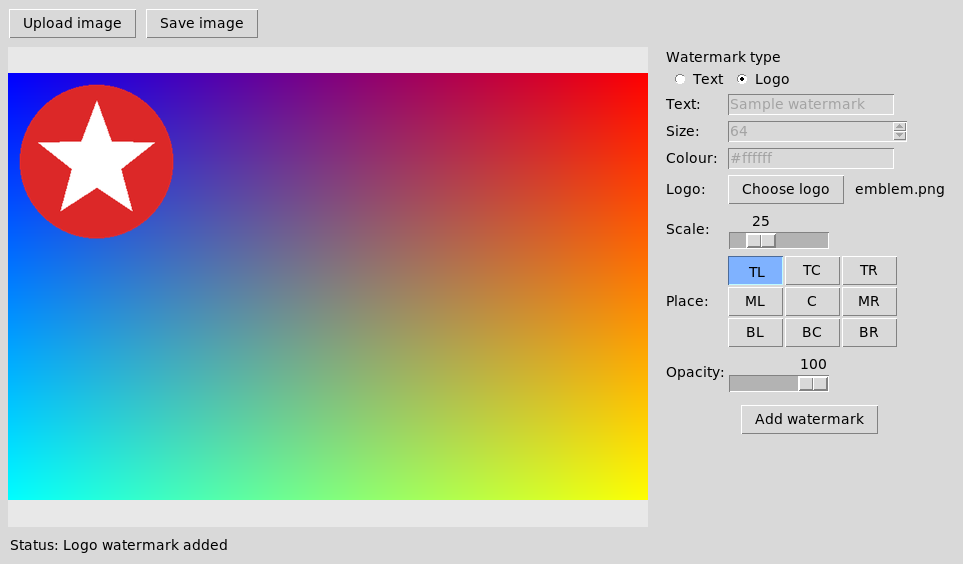
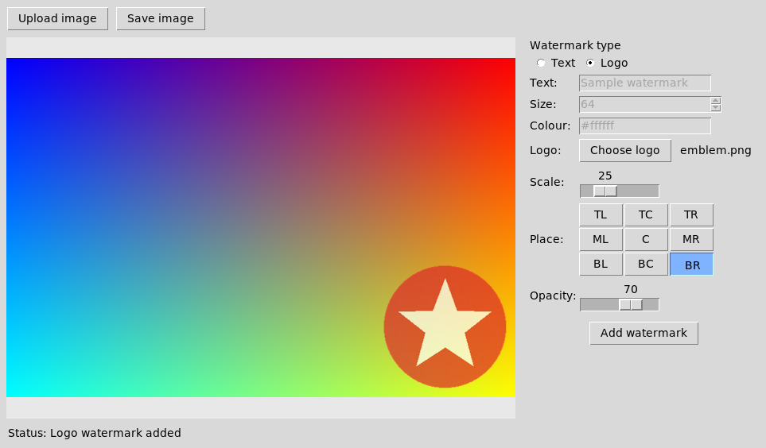
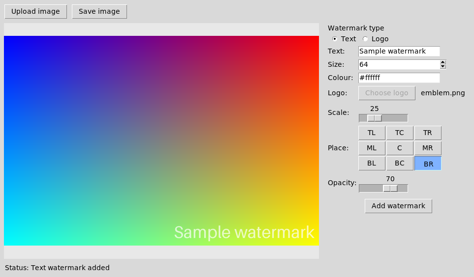

# 🚀 Watermark Image

A desktop application that uploads an image, adds a text or logo watermark and saves the result. It is the Day 85 assignment of the Udemy course "100 Days of Code: The Complete Python Pro Bootcamp", written for course participants and for visitors who want a readable, runnable example.

## 📚 Table of Contents

- [Overview](#-overview)
- [Requirements](#-requirements)
- [Setup](#-setup)
- [Run](#-run)
- [Step 1: upload](#-step-1-upload)
- [Step 2: text watermark](#-step-2-text-watermark)
- [Step 3: logo watermark](#-step-3-logo-watermark)
- [Step 4: save](#-step-4-save)
- [Reflection](#-reflection)
- [Tests](#-tests)
- [License](#-license)
- [Links](#-links)
- [Appendix: Project documents](#-appendix-project-documents)

## 🧭 Overview

The program is built in four steps, and each step has a screenshot here and a wiki page (English, Danish and Bahasa Malaysia) that explains what the step taught:

1. Step 1: a window where you upload an image (`upload_image`).
2. Step 2: a text watermark with position and opacity (`add_watermark`).
3. Step 3: a logo watermark.
4. Step 4: saving the result without touching the original (`save_image`).

The repository is laid out as follows:

| Folder or file | Holds |
| --- | --- |
| `src/watermark_image/` | The application, in layers: `domain`, `application`, `infrastructure` and `presentation` |
| `src/watermark_image/constants.py` | Every constant of the application |
| `tests/` | The pytest tests: `unit`, `integration` and `e2e` |
| `docs/` | Project documents, the wiki sources (`docs/wiki/`) and the screenshots (`docs/screenshots/`) |
| `docker/gui/` | The Linux container in which graphical tests and screenshots run |
| `scripts/` | `check.sh`, the quality gate, and `run-gui-tests.sh`, the container runner |
| `pyproject.toml` | The single configuration file of the project and its tools |
| `Doxyfile` | The Doxygen configuration for the source comments |

## 📋 Requirements

- Python 3.13 or newer, with Tkinter (included in the standard installers of Python).
- Pillow, the only runtime dependency: Tkinter alone cannot read JPEG files or blend a watermark with transparency.
- For development only: pytest, pytest-cov, ruff, mypy and import-linter (installed with the `dev` group), Doxygen for the source manual, Docker for graphical tests and screenshots, and opengrep for the security scan.

## 🛠️ Setup

Create a local virtual environment named `.venv`, activate it, upgrade pip and install the project.

On Windows (PowerShell):

```powershell
python -m venv .venv
.venv\Scripts\Activate.ps1
python -m pip install --upgrade pip
python -m pip install -e ".[dev]"
```

On Linux and macOS:

```bash
python3 -m venv .venv
source .venv/bin/activate
python -m pip install --upgrade pip
python -m pip install -e ".[dev]"
```

Leave the environment with `deactivate`. Install without the development tools with `python -m pip install -e .`.

## ▶️ Run

With the environment active:

```bash
python -m watermark_image
```

The program starts from step 1 on. The controls of each step are described in the wiki.

## 🖼️ Step 1: upload

The window has an **Upload image** button and a preview area. The wiki page [Step 1][wiki-step-1] explains what the step taught, in English, Danish and Bahasa Malaysia.

| At start | After upload |
| --- | --- |
|  |  |

## 🖋️ Step 2: text watermark

The control panel on the right takes a text, a size, a colour, one of nine places and an opacity; **Add watermark** lays the text over the picture and the original stays unchanged. The wiki page [Step 2][wiki-step-2] explains what the step taught, in English, Danish and Bahasa Malaysia.

| Text added | Placed in a corner |
| --- | --- |
|  |  |

## 🏷️ Step 3: logo watermark

Choose **Logo** as the watermark type, press **Choose logo**, pick a picture file and set its size as a percentage of the picture width. Place and opacity work as for the text. A logo with a transparent background lets the picture show through. The wiki page [Step 3][wiki-step-3] explains what the step taught, in English, Danish and Bahasa Malaysia.

| Logo added | Placed in a corner |
| --- | --- |
|  |  |

## 💾 Step 4: save

Once a watermark is added, **Save image** opens a save dialog and writes the marked picture to a new `.png`, `.jpg` or `.jpeg` file. Choosing the original file is refused, so the original is never overwritten. The wiki page [Step 4][wiki-step-4] explains what the step taught, in English, Danish and Bahasa Malaysia.

| Ready to save | Saved |
| --- | --- |
|  |  |

## 🪞 Reflection

The assignment ends with a reflection on the approach, what was hard and easy, and what to do differently. The wiki page [Reflection][wiki-reflection] holds a draft, in English, Danish and Bahasa Malaysia.

## 🧪 Tests

With the environment active:

```bash
python -m pytest
```

Before a push, run the whole quality gate (tests with coverage, ruff, mypy, import-linter and the opengrep scan):

```bash
bash scripts/check.sh
```

Graphical tests and screenshots never run on your desktop. They run in a Linux container with a virtual display:

```bash
bash scripts/run-gui-tests.sh python -m pytest -m gui
```

Build the source manual with `doxygen Doxyfile`; it is written to `build/doxygen/index.html`.

## 📄 License

GNU Affero General Public License, version 3. See the [LICENSE][license] file.

## 🔗 Links

- [Repository][repository]
- [Documentation][documentation]
- [Issue tracker][issues]
- [Pillow][pillow] and the [Tkinter documentation][tkinter], the two references of the assignment
- [Watermarkly][watermarkly], a similar online service

## 📎 Appendix: Project documents

The documents a newcomer needs, in reading order.

| Document | What it tells you |
| --- | --- |
| [Business Case][BC-001] | Why the project exists, its scope and success criteria |
| [Stakeholder Analysis][SA-001] | Who is involved; the stakeholder IDs used for owners and reviewers |
| [Project Plan][PP-001] | The gateways and their schedule |
| [Milestones][milestones] | One document per gateway: Go/No-Go criteria and tasks |
| [Artifact registry][registry] | Where each artifact type lives, the next version, the PO language and domain |
| [Traceability matrix][TM-001] | How the artifacts link and when each was last reviewed |
| [Framework README][framework-readme] | The framework this project uses |
| [Framework changelog][framework-changelog] | What changed in each framework release |

---

[repository]: https://git.tirsystem.com/Tirsvad-Udemy-100-days-of-code/085-assignment-watermark-image
[documentation]: https://git.tirsystem.com/Tirsvad-Udemy-100-days-of-code/085-assignment-watermark-image/wiki
[issues]: https://git.tirsystem.com/Tirsvad-Udemy-100-days-of-code/085-assignment-watermark-image/issues
[wiki-step-1]: https://git.tirsystem.com/Tirsvad-Udemy-100-days-of-code/085-assignment-watermark-image/wiki/Step-1-Upload
[wiki-step-2]: https://git.tirsystem.com/Tirsvad-Udemy-100-days-of-code/085-assignment-watermark-image/wiki/Step-2-Text-Watermark
[wiki-step-3]: https://git.tirsystem.com/Tirsvad-Udemy-100-days-of-code/085-assignment-watermark-image/wiki/Step-3-Logo-Watermark
[wiki-step-4]: https://git.tirsystem.com/Tirsvad-Udemy-100-days-of-code/085-assignment-watermark-image/wiki/Step-4-Save
[wiki-reflection]: https://git.tirsystem.com/Tirsvad-Udemy-100-days-of-code/085-assignment-watermark-image/wiki/Reflection
[pillow]: https://pypi.org/project/Pillow/
[tkinter]: https://docs.python.org/3/library/tkinter.html
[watermarkly]: https://watermarkly.com/
[license]: ./LICENSE
[BC-001]: ./docs/business-case.md
[SA-001]: ./docs/stakeholder-analysis.md
[PP-001]: ./docs/project-plan.md
[milestones]: ./docs/milestones/
[registry]: ./docs/artifact-registry.md
[TM-001]: ./docs/sqa/traceability-matrix.md
[framework-readme]: ./framework/README.md
[framework-changelog]: ./framework/CHANGELOG.md
