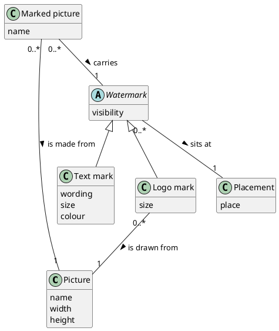

# Domain Model: Watermark Image

## Metadata
| Key | Value |
| --- | --- |
| ID | DM-002 |
| CrossReference | [UC-001], [UCD-001], [SA-001], [DM-001] |
| Language | en |
| Domain | it |

## Version History
| Date | Status | Author | Reviewer | Change | Commit |
| --- | --- | --- | --- | --- | --- |
| 2026-11-20 | Accepted | Jens Tirsvad Nielsen | Stand-in for S01 | Initial version Accepted on Go in RC-021 | [2a87378] |

---

## Purpose and Scope

This is the project Domain Model, in the Product Owner's words. Today it holds the concepts of use case [UC-001], "Watermark an image". It answers the concerns CN-001 (the watermark is added correctly) and CN-009 (the original picture stays unchanged) of [SA-001] and serves S01 and S02. Marking always starts from the original picture: when the User changes the watermark, a new marked picture is made from the original picture, so the original is never touched. Each later use case adds its concepts here.

## Diagram

## Concept Table

| Concept | Definition | Attributes | Source (use case noun phrase / glossary) |
| --- | --- | --- | --- |
| Picture | A photograph or drawing that a person owns and wants to mark. | name, width, height | "picture" in UC-001 steps 1 and 2 |
| Watermark | A mark laid over a picture to show who it belongs to, more or less visible. | visibility | "watermark" in steps 3 and 4 |
| Text mark | A watermark made of words. | wording, size, colour | "text" in step 3 |
| Logo mark | A watermark made from a small picture, such as a brand symbol. | size | "logo picture" in step 3 |
| Placement | The spot on a picture where a watermark sits: a corner, the middle of an edge or the centre. | place | "place on the picture" in step 3 |
| Marked picture | A picture with a watermark laid over it, kept apart from the original picture. | name | "marked picture" in step 7 |

## Association Table

| From | Association name (with reading direction) | To | Multiplicity (both ends) |
| --- | --- | --- | --- |
| Marked picture | is made from | Picture | 0..* to 1 |
| Marked picture | carries | Watermark | 0..* to 1 |
| Watermark | sits at | Placement | 0..* to 1 |
| Logo mark | is drawn from | Picture | 0..* to 1 |

## Generalizations

- Text mark is a Watermark: words laid over a picture are a watermark.
- Logo mark is a Watermark: a small picture laid over a picture is a watermark.

---

---

---

[DM-001]: use-cases/uc-001/dm.md
[SA-001]: stakeholder-analysis.md
[UC-001]: ./use-cases/uc-001/uc.md
[UCD-001]: ./use-case-diagram.md
[2a87378]: https://git.tirsystem.com/Tirsvad-Udemy-100-days-of-code/085-assignment-watermark-image/commit/2a87378078601878cb390c2d31581159df822d6f
