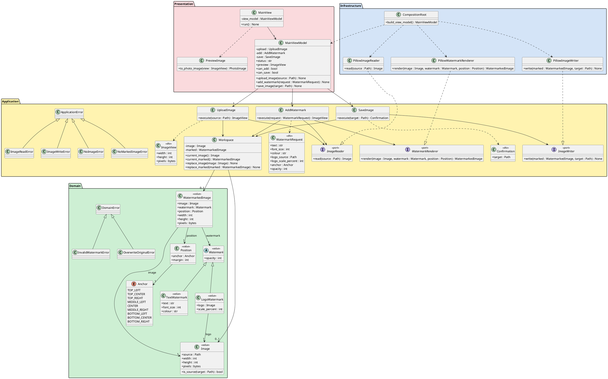

# Design Class Diagram: UC-001 Watermark an image

## Metadata
| Key | Value |
| --- | --- |
| ID | DCD-001 |
| CrossReference | [DM-002], [SD-001], [DICT-001], [OC-001], [SA-001] |

## Version History
| Date | Status | Author | Reviewer | Change | Commit |
| --- | --- | --- | --- | --- | --- |
| 2026-11-20 | Accepted | Jens Tirsvad Nielsen | Stand-in for S01 | Initial version Accepted on Go in RC-026 | [2a87378] |

---

## Purpose and Scope

This diagram shows the classes of use case [UC-001], "Watermark an image". No project Design Class Diagram existed before it, so every class here is new and is added to it right after this acceptance. It answers the concerns CN-001 (the watermark is added correctly) and CN-009 (the original stays unchanged) of [SA-001] and serves the developer S01 and the readers S02, who browse the code. Class and attribute names are the IT terms of [DICT-001]. The layers follow ADR-0002 and the diagrams of [SD-001]; the code under `src/watermark_image/` is written from this diagram.

## Diagram

Package dependencies: Presentation depends on Application and Domain; Infrastructure depends on Application and Domain; Application depends on Domain; Domain depends on nothing. The ports are owned by the Application layer and implemented by the Infrastructure layer; the CompositionRoot is the only place where the two meet.

## Class Table

| Class | Refines (Domain Model concept) | Responsibility | Attributes | Operations |
| --- | --- | --- | --- | --- |
| Anchor | Place | Names the nine places on a picture | nine members | none |
| Image | Picture | Holds a loaded picture and tells whether a file is its source | source, width, height, pixels | `is_source` |
| Position | Placement | Holds where a watermark sits and the margin from the edge | anchor, margin | none |
| Watermark | Watermark | Holds the visibility shared by every watermark and refuses a value outside 0 to 100 | opacity | none |
| TextWatermark | Text mark | Holds words, size and colour and refuses empty text or a size below 1 | text, font_size, colour | none |
| LogoWatermark | Logo mark | Holds a logo Image and its size and refuses a size outside 1 to 100 | logo, scale_percent | none |
| WatermarkedImage | Marked picture | Holds the result with the Image, Watermark and Position it came from | image, watermark, position, width, height, pixels | none |
| DomainError, InvalidWatermarkError, OverwriteOriginalError | none (technical classes: error types) | Signal a refused value or a refused target | none | none |
| ImageReader, WatermarkRenderer, ImageWriter | none (technical classes: ports) | State what the use cases need from the outside | none | `read`, `render`, `write` |
| Workspace | none (technical class: holder of the current state) | Keeps the current Image and WatermarkedImage | image, marked | `current_image`, `current_marked`, `replace_image`, `replace_marked` |
| WatermarkRequest, ImageView, Confirmation | none (technical classes: data transfer objects) | Carry the input and the result between layers | see diagram | none |
| UploadImage, AddWatermark, SaveImage | none (technical classes: use cases) | Carry out one system operation each | the ports and the Workspace they use | `execute` |
| ApplicationError and its four kinds | none (technical classes: error types) | Signal a refused operation | none | none |
| PillowImageReader, PillowWatermarkRenderer, PillowImageWriter | none (technical classes: adapters) | Read, draw and write pictures with the picture library | none | `read`, `render`, `write` |
| CompositionRoot | none (technical class) | Builds the objects and joins ports to adapters | none | `build_view_model` |
| MainViewModel | none (technical class: view model) | Holds what the window shows and forwards the three operations | status, preview, can_add, can_save | `upload_image`, `add_watermark`, `save_image` |
| MainView | none (technical class: window) | Draws the window of the wireframe and forwards input | view_model | `run` |
| PreviewImage | none (technical class: helper) | Turns an ImageView into a picture the window can draw, scaled to fit | none | `to_photo_image` |

SOLID is applied: each class has one responsibility, the use cases depend on ports and not on adapters, and no class holds more than one reason to change.

## Method Traceability

| Method signature | Operation Contract / SD message |
| --- | --- |
| `MainViewModel.upload_image(source)` | OC-001 upload_image; SD-001 upload_image |
| `UploadImage.execute(source)` | OC-001 upload_image |
| `ImageReader.read(source)`, `PillowImageReader.read(source)` | SD-001 upload_image and add_watermark (logo) |
| `Workspace.replace_image(image)` | SD-001 upload_image |
| `Image` creation | SD-001 upload_image |
| `MainViewModel.add_watermark(request)`, `AddWatermark.execute(request)` | OC-001 add_watermark |
| `Workspace.current_image()`, `Workspace.replace_marked(marked)` | SD-001 add_watermark |
| `WatermarkRenderer.render(...)`, `PillowWatermarkRenderer.render(...)` | SD-001 add_watermark |
| `MainViewModel.save_image(target)`, `SaveImage.execute(target)` | OC-001 save_image |
| `Workspace.current_marked()` | SD-001 save_image |
| `Image.is_source(target)` | SD-001 save_image |
| `ImageWriter.write(...)`, `PillowImageWriter.write(...)` | SD-001 save_image |
| `PreviewImage.to_photo_image(view)`, `MainView.run()` | Wireframe of UC-001 (the screen of every operation) |
| `CompositionRoot.build_view_model()` | Technical: starts the program; no contract |

## Pattern Annotations

| Pattern | Classes | Rationale |
| --- | --- | --- |
| Port and adapter (Hexagonal) | ImageReader, WatermarkRenderer, ImageWriter and the Pillow classes | The picture library stays outside the Application and Domain layers |
| Model View ViewModel | MainView, MainViewModel | The window holds no logic; the view model is testable without a display |
| Value Object | Image, Position, Watermark and its kinds, WatermarkedImage | Immutable and validated at creation |
| Strategy | WatermarkRenderer | The way a mark is drawn can be replaced |
| Composition root | CompositionRoot | One place where objects are built |
| Data Transfer Object | WatermarkRequest, ImageView, Confirmation | The view model never touches Domain objects directly |

## Dependency Check

No class or package depends on itself, directly or through others. Every dependency points inward: the Domain classes import nothing from the other layers, the Application classes import only Domain classes and their own ports, and the Infrastructure and Presentation classes import the Application and Domain layers. The Domain classes and the Application ports contain no Pillow or Tkinter type: pixels are plain `bytes` in RGBA order.

---

[SA-001]: ../../stakeholder-analysis.md

---

[DM-002]: ../../domain-model.md
[SD-001]: ./sd.md
[DICT-001]: ../../dictionary.md
[OC-001]: ./oc.md
[2a87378]: https://git.tirsystem.com/Tirsvad-Udemy-100-days-of-code/085-assignment-watermark-image/commit/2a87378078601878cb390c2d31581159df822d6f
