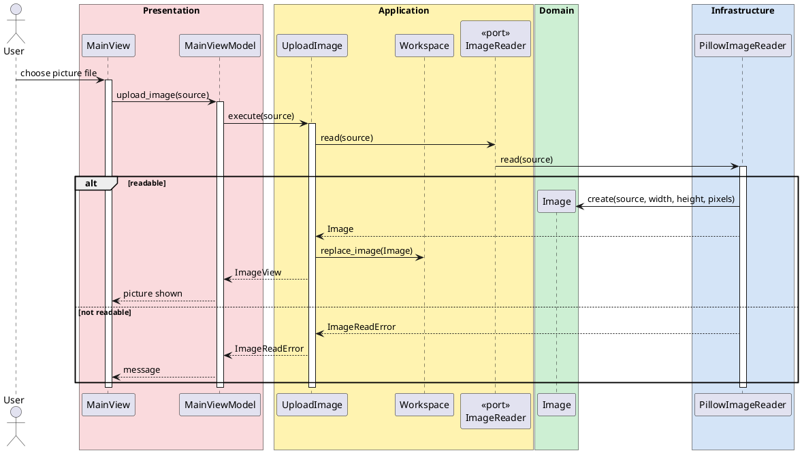
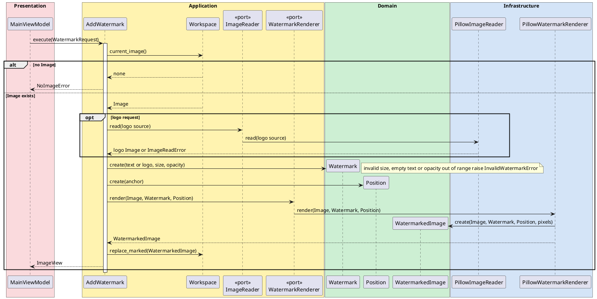
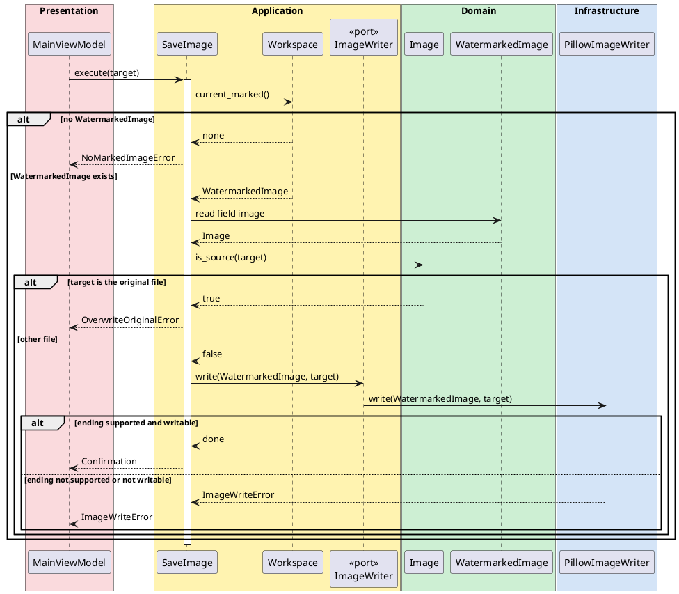

# Sequence Diagrams: UC-001 Watermark an image

## Metadata
| Key | Value |
| --- | --- |
| ID | SD-001 |
| CrossReference | [OC-001], [DICT-001], [SA-001] |

## Version History
| Date | Status | Author | Reviewer | Change | Commit |
| --- | --- | --- | --- | --- | --- |
| 2026-11-20 | Deprecated | Jens Tirsvad Nielsen | Stand-in for S01 | Initial version Accepted on Go in RC-025 | [2a87378] |
| 2026-11-20 | Accepted | Jens Tirsvad Nielsen | Stand-in for S01 | Aligned with the code of gateway 6: the image is a field of the marked picture; paths compared resolved Accepted on Go in RC-037 | [1f65014] |

---

## Purpose

These diagrams show how the objects of [UC-001] carry out the three contracts of [OC-001]. They answer the concerns CN-001 (the watermark is added correctly) and CN-009 (the original stays unchanged) of [SA-001] and serve the developer S01 and the readers S02. The layers follow ADR-0002: Presentation (Delivery), Application, Domain and Infrastructure. Every call into the Infrastructure layer goes through a port that the Application layer owns; the Infrastructure objects implement the ports.

## Realizes: upload_image

**Pattern Annotations**

| Pattern (GRASP/GoF) | Applied to | Rationale |
| --- | --- | --- |
| Controller (GRASP) | MainViewModel | Receives the system operation from the view and hands it to a use case |
| Port and adapter (Hexagonal) | ImageReader, PillowImageReader | The Application layer does not know the picture library |
| Information Expert (GRASP) | Workspace | Holds the current Image and WatermarkedImage |

**Postcondition Coverage**

| Postcondition | Satisfied by message |
| --- | --- |
| An Image instance was created with its width and height | `create(source, width, height, pixels)` |
| Earlier Image and WatermarkedImage were dropped | `replace_image(Image)` |
| The returned ImageView shows the new Image | `ImageView` return |
| Exception: not readable, earlier state kept | `ImageReadError` branch; Workspace is not called |

**Responsibility Check:** the view only forwards; the use case coordinates; the port reads; the Workspace keeps state. No object receives every message.

## Realizes: add_watermark

**Pattern Annotations**

| Pattern (GRASP/GoF) | Applied to | Rationale |
| --- | --- | --- |
| Creator (GRASP) | AddWatermark creates Watermark and Position | It holds the data to initialise them |
| Value Object (DDD) | Watermark, Position | Invalid values are refused at creation |
| Strategy (GoF) | WatermarkRenderer port | The way a mark is drawn can be replaced without touching the use case |
| Port and adapter (Hexagonal) | ImageReader, WatermarkRenderer | The Application layer does not import the picture library |

**Postcondition Coverage**

| Postcondition | Satisfied by message |
| --- | --- |
| Watermark created and associated with a Position with the given Anchor | `create(text or logo, size, opacity)` and `create(anchor)` |
| WatermarkedImage created and associated with Image and Watermark; earlier one dropped | `create(Image, Watermark, Position, pixels)` and `replace_marked` |
| The Image was not modified | the renderer returns a new WatermarkedImage; the Image is never passed to the Workspace again |
| ImageView returned | `ImageView` return |
| Exceptions: no Image, invalid values, unreadable logo | `NoImageError`, `InvalidWatermarkError` and `ImageReadError` raised before `replace_marked`, so nothing changes |

**Responsibility Check:** validation lives in the Domain objects, drawing in the Infrastructure adapter, coordination in the use case.

## Realizes: save_image

**Pattern Annotations**

| Pattern (GRASP/GoF) | Applied to | Rationale |
| --- | --- | --- |
| Information Expert (GRASP) | Image answers `is_source` | It knows where it came from; paths are compared in resolved form |
| Port and adapter (Hexagonal) | ImageWriter, PillowImageWriter | The Application layer does not import the picture library |
| Protected Variations (GRASP) | ImageWriter port | A new file format changes only the adapter |

**Postcondition Coverage**

| Postcondition | Satisfied by message |
| --- | --- |
| The WatermarkedImage was stored under the target name | `write(WatermarkedImage, target)` |
| Image and WatermarkedImage not modified | only reads are made on both; the writer receives a copy of the pixels |
| Confirmation holds the target name | `Confirmation` return |
| Exceptions: none to save, original file, unsupported or unwritable | `NoMarkedImageError`, `OverwriteOriginalError`, `ImageWriteError`; nothing is stored and the WatermarkedImage is kept |

**Responsibility Check:** the check of the original lives in the Image, the write in the adapter, the order in the use case.

---

---

[OC-001]: ./oc.md
[DICT-001]: ../../dictionary.md
[SA-001]: ../../stakeholder-analysis.md
[2a87378]: https://git.tirsystem.com/Tirsvad-Udemy-100-days-of-code/085-assignment-watermark-image/commit/2a87378078601878cb390c2d31581159df822d6f
[1f65014]: https://git.tirsystem.com/Tirsvad-Udemy-100-days-of-code/085-assignment-watermark-image/commit/1f65014ef092535eb0a994f618cc348d58dbd97a
