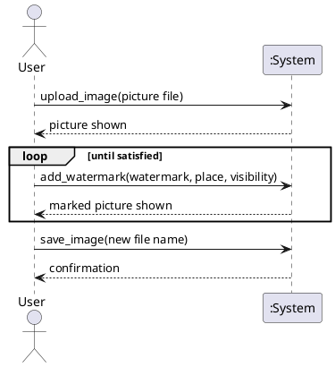
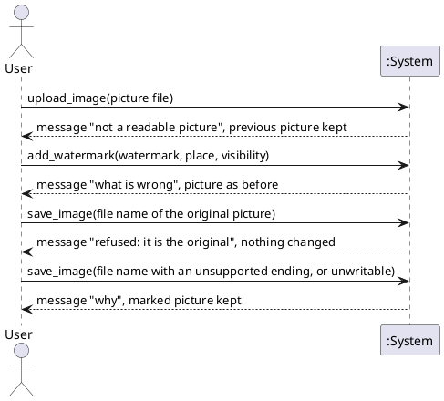

# System Sequence Diagram: UC-001 Watermark an image

## Metadata
| Key | Value |
| --- | --- |
| ID | SSD-001 |
| CrossReference | [UC-001], [DM-002], [UC-001] |
| Language | en |
| Domain | it |

## Version History
| Date | Status | Author | Reviewer | Change | Commit |
| --- | --- | --- | --- | --- | --- |
| 2026-11-20 | Accepted | Jens Tirsvad Nielsen | Stand-in for S01 | Initial version Accepted on Go in RC-022 | pending |

---

## Source Use Case

[UC-001], "Watermark an image": the main success scenario. The extensions are depicted in the second diagram.

## Diagram

Alternative flows, in one diagram:

## System Operations Table

| Step | Message (verb phrase) | Parameters | Return | Use case step |
| --- | --- | --- | --- | --- |
| 1 | upload_image | picture file | the picture, or the message of extension 2a | 1, 2, 2a |
| 2 | add_watermark | watermark (text with size and colour, or logo picture with size), place, visibility | the marked picture, or the message of extension 3a or 3b | 3, 4, 5, 3a, 3b |
| 3 | save_image | new file name | confirmation, or the message of extension 6a or 6b | 6, 7, 6a, 6b |

The message names are the function names the assignment asks for; they become the Operation Contract names. Repeating step 3 of the use case (step 5) repeats the message `add_watermark`.

## Lifecycle Notes

The system exists for as long as the program runs; one picture is worked on at a time. A new `upload_image` replaces the picture being worked on and drops the marked picture.

---

---

[UC-001]: ./uc.md
[DM-002]: ../../domain-model.md
[UC-001]: ./uc.md
